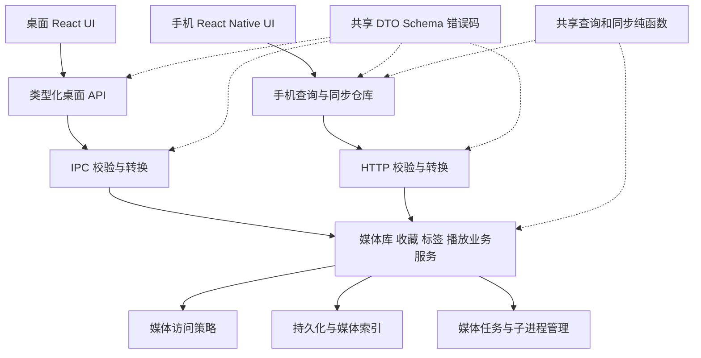

# Wallpaper Player 桌面端与手机端审查及重构方案

审查日期：2026 年 10 月 14 日（Asia/Shanghai）。代码基线：`ee9c792`。桌面版本：`1.5.1`；手机版本：`0.1.4`。

建议保留 Electron、React 和 Expo / React Native，采用渐进式重构。当前最需要解决的是隐私访问边界和并发数据修改，其次是手机全量拉库、播放恢复与跨设备同步。已有主进程模块、播放器、缓存和插件体系可以继续使用，改造应围绕业务责任和协议一致性展开。

## 文档基线与实施状态

实施状态与各阶段验证结果见[重构实施记录](refactor-progress.md)。下方“当前代码复核”描述 2026 年 10 月 15 日的剩余工作；其后的原始问题、代码行号、依赖版本、审计数字和工期估算保留为 10 月 14 日改造前基线，不能直接当作当前仍存在的缺陷或剩余工期。

依赖治理阶段更新：桌面已验证 Electron44.9.0、Vite8.3.4；手机经 SDK57 中间节点升级至 Expo58 / React Native0.88.0，并完成独立优化 Android x86_64 包的本机检查点。SDK58 推荐补丁阶段随后升至 Expo58.0.17，配套相机/视频/剪贴板/状态栏补丁及该阶段 Expo Doctor20/20、独立测试身份覆盖安装通过，见[SDK58补丁证据](evidence/r8-sdk58-patches.json)。Xcode 的 uuid 依赖已定向升级，node-forge 与 braces 另有本地回补；最后记录的官方 audit 仍为15项 high，不能将本地补丁称为上游正式修复。详细范围见[依赖治理](dependency-governance.md)、[SDK58证据](evidence/r8-expo58.json)与[UUID证据](evidence/r8-xcode-uuid.json)。

10月23日补充：node-forge 的固定版本/integrity/源码摘要验签回补、braces 的深度边界与外部 AST 队列隔离回补均已完成相应安装/消费者回归，见[Forge证据](evidence/r8-forge-backport.json)和[braces证据](evidence/r8-braces-depth.json)。两者的更广输入/资源边界、上游正式修复和 Node 工具风险仍不能据此全部关闭。首次相机授权二次点击问题已另行修复，并在完整生产 UI 的独立 Android 包中完成7项原生权限/取消/前后台流程及真实模拟相机打开释放检查，见[相机权限证据](evidence/r7-camera-permission.json)。生产签名/身份迁移、物理设备/长时预算、iOS原生和发布/更新/TLS仍保留未完成；不能继续把已通过的 SDK58 补丁或相机子项列为待实施。

## 当前代码复核与剩余执行方案（2026 年 10 月 15 日）

R1–R4 已完成针对性修复，R5 已完成本机查询与分页验收；R6 已包含两端播放会话、任务资源预算、取消和退出、下载账本、mpv 安装及旧版本回收。R7 已完成设置所有权、配置仓库、全局快照、启动恢复、异步密码、有界 JSON 与路径解析，以及桌面窄窗和手机库首批适配；桌面消费点已接入选择器并取得 Profiler 对比。媒体修改/身份仓库等同步读取、JSON 准备、首次启动稳定性与双端完整/原生验收继续实施。R8 已先完成统一 IPC 来源门控，其他升级与交付项目仍待实施。保留现有 Electron / React / Expo 结构与已落地的共享业务服务，完整实施状态和证据范围以实施记录为准。

| 优先级与范围 | 当前依据 | 下一步改造 | 完成条件 |
| --- | --- | --- | --- |
| 已完成的 P1 桌面特权入口（R8 先行项） | 核心及插件注册默认接入 main/security/ipc.js；main/window.js 绑定明确入口，并对导航和重定向应用同一规则 | 后续新增通道沿用该注册门面；合法请求已提交的修改与导航取消的媒体任务分别保持原有语义 | verify:ipc-sender 已在实际 Electron 中覆盖 104 个生产通道及 2 个验证通道、真实子 frame、其他窗口、错误开发端口、非入口文件和过期异步返回；合法应用、插件装卸及 ASAR 回归通过 |
| P1 两端播放器验收（R6，桌面本机资源子项已验收） | 当前整包已完成真实 Windows mpv 的 30 轮进出/切换、约 15 分钟 10k 查询/缩略图并发及 5 分钟空闲；原生进程和完整订阅表不累积，剩余手机与环境矩阵仍开放 | 继续其他 Windows/显示器/媒体与网络条件；手机原生首帧、滑动/旋转及 60 分钟 PSS/帧率采集 | 本机查询/主进程 p95 为 12.54/19.91ms，资源槽/子进程收尾归零，条件见[原生资源证据](evidence/r6-native-10k-resources.json)；不能替代真实手机首帧、帧率、LAN 与 PSS 预算。暂无真机，保留未验收状态 |
| P2 桌面状态消费（R7，第一轮完成） | AppProvider 已持有提交后发布的稳定仓库，实际消费点已接入字段/标量选择器；卡片按视频订阅，设置广播复用未变 JSON 分支 | 保持新增消费点使用选择器；继续按实际功能拆分壳组件与类型化入口，并补齐其他设置和双端界面矩阵 | 真实 React/Electron 10k 库、一页 100 卡片的前后对比通过：20 次分析更新的卡片渲染 2000→0，单视频收藏 2000→20；搜索、选择、标签、Suspense 提交边界及退订已验证，条件见实施记录 |
| P2 设置与主进程响应（R7，部分完成） | 设置所有权/快照/启动恢复、按字段补丁与媒体事务仓库、后台编码、增量广播/局部读取与版本回执已改造；协商请求读取、完整回退及旧订阅广播已移至 worker，广播队列有界；播放器准备已按目标/字段读取；身份请求/发送边界异步刷新，配对与撤销串行原子替换；密码、JSON gzip、扫描/库及媒体修改路径异步有界 | 继续处理冷启动读取/规范化、其他旧配置读取与完整修改回复、未协商兼容完整读取/广播及旧回调接口、逐实体更新、旧路径准备及 renderer/IPC 准备、显式路径/旧插件桥同步工作；观察内存稳定性；继续仓库职责、功能拆分及类型化入口；跨文件崩溃恢复留在 R8 | 请求读取/广播/播放器准备新增 9/8/8 项受控回归，另有 9 项隐藏 Electron/沙箱 IPC 及实际 ASAR worker 检查；1 万标签的本地/已入库网络播放准备整库主线程 JSON.parse 为 3/4→0 次，尚非持续延迟/内存预算通过，见[读取](evidence/r7-settings-read.json)、[广播](evidence/r7-settings-broadcast.json)及[播放器证据](evidence/r7-player-settings-read.json)。既有字段/路径、feed、回执及双端行为检查保持；其他完整准备仍未闭环 |
| P2 两端界面与可访问性（R7，分批完成） | 桌面窄窗导航/搜索、模态焦点及减少动画已改造；手机库、设备绑定/进度输入，以及播放设置/标签/分析的模态、草稿、键盘和大字体已改造；播放器业务和其他页面仍需拆分 | 继续未覆盖页面/手势及播放器业务拆分；验证系统 DPI/多屏和完整手机原生安全区、读屏/减少动态效果矩阵；保持真实返回位置 | 实际 Electron 24 组窗口/页面缩放/主题及焦点检查通过；手机受控回归、两端 Hermes，以及隔离 API 36 窄屏/键盘/大字体面板检查通过，条件见实施记录；物理手机、iOS 原生和完整矩阵继续验收 |
| P1 发布可靠性与 P2 依赖治理（R8） | release.yml 先发布 Windows，再按手动选项构建 APK；原审计仅是历史基线；手机签名、覆盖安装与 iOS 原生矩阵未闭环 | 重新按运行时与构建路径审计；分别升级 Electron、Web 和 Expo 组合；明确桌面独立发布及联合发布 gate；生成包含平台/ABI/版本/协议/哈希/签名信息的更新清单；TLS 原型独立验证 | Android 覆盖安装与失败阻断验证通过；更新平台匹配、中文用户路径和便携数据回滚有记录；iOS 只在签名构建与真机通过后标为可交付 |

执行次序：IPC 来源门控已作为独立安全修复验证通过；继续完成 R6 可执行的原生验证，R7 每次只迁移一个真实消费链并附前后测量；R8 其余依赖、数据迁移、更新和签名拆成可回滚交付。缺少真机时可继续独立的界面与工程工作，原生验收门槛保留，不以结构测试代替。

本轮额外核对并通过：mpv 版本缓存与真实本机安装链路、桌面播放器、异步准备、实际 Electron/ASAR、退出持久化、127 个桥方法/115 个通道、桌面构建、手机 typecheck、手机正确性与播放 adapter 行为回归及 diff 检查。手机行为测试包含实际两手机身份的 HTTP 请求和受控播放器，不是两台真机。真实手机设备列表为空，未执行手机原生或安装签名验收。本轮未重新执行 npm audit，后文审计数字仍是历史结果。

## 10 月 18 日实施补记

R7 第十批已补齐手机设备卡片、绑定表单与扫描取消、进度事件顺序，以及读屏/减少动态效果的首批处理；第十一批继续统一播放设置、标签和分析的模态所有权、后台草稿、键盘避让和大字体编排，保留全屏命令入口，修复信息/进度重叠及移除确认返回。类型检查、行为回归和 Android/iOS 生产 Hermes 源码校验通过。

隔离 API 36 调试包已检查 320 dp、普通/2.5 倍字体的设备/绑定与播放器面板，以及亮色 2.5 倍字体短横屏；实际范围、前后截图、合成绑定与分析条件见 [实施记录](refactor-progress.md) 和 [面板证据](evidence/r7-player-panels.json)。普通调试开发服务器连接仍需排查，当前本机检查使用内嵌生产 Hermes。继续处理其余同步热点、首次启动稳定性、功能/类型拆分和双端完整原生矩阵。此补记不将改造前缺陷重新算作当前问题，也不将受控宿主或模拟器结果记为物理手机验收。

R7 第十二批已将桌面/手机共用媒体修改链的旧路径、权限准备和批量目标解析改为有界异步处理，保留 CAS、幂等和落盘后发布。512 个旧键的八项追加采样约从 1.50 秒降至 42 ms，媒体路径同步 realpath 次数从 7664 降为零；10240 旧键仍有较长的数据准备与约 95 ms 的最大心跳观察，不能宣称全部响应预算达标。设置根目录规范化、身份读与完整配置复制/序列化继续实施，详见 [媒体修改路径证据](evidence/r7-media-mutation-paths.json)。

R7 第十三批继续按修改字段合并设置，减少普通提交中的重复整库处理，并隔离入队及写入期间的普通补丁输入。一万条标签的三组交替采样中，收藏/主题提交耗时中位数约从 90/97 ms 降至 60/59 ms；13 项提交生命周期、实际 Electron 快照 UI、媒体事务、标签冲突和 ASAR 检查通过。仍保留完整配置复制、显式路径设置与身份 IO 等后续工作；测量条件、并行验证期间的较慢观察和限制见 [设置提交证据](evidence/r7-settings-commit.json)，整个 R7 与原生交付尚未完成。

R7 第十四批将普通鉴权和发送前身份刷新改为异步，配对/撤销/Token 轮换使用串行原子写入，最近访问记录后台合并。100 个配对记录的三组本机采样中，并发 16 次鉴权约从 35 ms 降至 16 ms，身份同步读取从 48 次降为零；顺序 20 次请求耗时约 53→55 ms，未显示改善。15 项生命周期、实际撤销/流/分析、桌面 UI、手机行为及 ASAR 检查通过。旧插件同步辅助入口及本地首次兼容回退仍保留，其他剩余项不变，详见 [身份 IO 证据](evidence/r7-identity-io.json)。

## 10 月 19 日实施补记

R7 第十五批将普通设置提交的整库 JSON 编码移入一个可回收的后台线程，复用私有规范文本并仅发送修改字段；手机修改省去未消费的完整设置返回，桌面保留原有快照契约。三组一万标签的本机仓库采样中，收藏/主题总耗时中位数约 57/56→38/36 ms；整份标签与只读耗时未见改善，进程 RSS 有增加。14 项线程/设置生命周期、桌面实际 UI、手机行为与 ASAR 检查通过；读取/广播、renderer/IPC 准备、冷启动和完整原生指标仍未闭环。条件、内存观察及限制见 [设置 JSON 证据](evidence/r7-settings-json.json)。

R7 第十六批新增受窗口/frame/导航世代保护的设置增量 feed，兼容旧完整订阅，并让库失效/分析插件消费提交元数据；手机进度 GET 和网络目标检查使用局部设置读取。三组一万标签的 Node 发送模型采样中，主题/进度总耗时约 50/49→32/31 ms、单视频标签约 80→81 ms；广播 JSON 约 1.52 MB 降至 270–526 字节。实际 Electron 已验证丢事件恢复、旧监听共存和跨页面隔离，完整 App UI/手机行为/ASAR 回归及 Android/iOS Hermes 导出通过。初次读取、完整恢复和桌面修改回复仍保留完整副本，原生持续响应预算未据此通过；测试曾误写项目回退设置文件，已修正隔离，原始内容无备份，现状保留。详见 [增量设置证据](evidence/r7-settings-feed.json) 与 [实施记录](refactor-progress.md)。

R7 第十七批将当前配置、收藏及标签 IPC 的完整设置返回改为显式版本回执，旧调用保留完整结果；保存校验改用局部字段。真实完整 App 已验证收藏按钮与标签编辑器丢失末条增量时各补读一次恢复。三组一万个生成标签键的 Node IPC 模型中，主题/收藏总耗时约 25/38→13/21 ms、标签读取/替换约 243/295→224/274 ms，返回 JSON 约 0.50 MB 降至 96–327 字节。10 项回执生命周期、桌面 UI/手机行为、Hermes/ASAR 通过；媒体准备副本、完整恢复与其他 IPC 返回仍保留，解码并发等指标未据此通过。详见 [版本回执证据](evidence/r7-settings-replies.json)。

R7 第十八批为收藏、标签及进度建立按操作限定字段的媒体事务仓库，准备只读取独立键名/必要字段；网络目标查询只复制网络资源。已知文件/Workshop/URL 标识不再作为本地路径解析，旧路径别名仍逐项复核。一万个混合标识、另有一万条进度的三组本机采样中，标签读取/替换约 255/299→12/74 ms，异步路径解析 10006→5；10240 个旧路径读取仍约 492→486 ms，未显示实质改善。8 项仓库及 12 项路径生命周期、实际桌面交互、手机 HTTP/行为与 ASAR 回归通过。本批既有远程库测试另有隔离缺陷，改写了项目回退设置/身份/缓存；已修正并验证全目录文件摘要不变，原内容无备份，现存文件保留，详情见实施记录。完整复制/逐实体修改、旧数据准备及其他原生交付条件仍未闭环，详见 [媒体字段证据](evidence/r7-media-fields.json)。

R8 设置恢复首批已新增 schemaVersion、滚动备份与启动前恢复选择；损坏、权限错误及未来版本不再默默变为默认设置。19 项存储/进程中断/插件边界、5 项实际 Electron 启动和 ASAR 恢复检查通过；对话框回答受控，未执行断电或完整跨文件恢复。88 个 Node/Electron 验证入口增加项目回退数据写入保护，原有 42 个回退文件摘要保持不变。设置之外的身份/手机本地仓库、完整迁移日志、依赖和原生交付继续处理，详见 [设置恢复证据](evidence/r8-settings-recovery.json) 与 [实施记录](refactor-progress.md)。

## 原始审查范围与现状（改造前基线）

范围覆盖 Windows 桌面 UI、Electron 主进程与 IPC、局域网 API、手机库页与播放器、设备绑定与本地持久化、转码和缩略图任务、插件集成、依赖及发布流程。手机方案以已有 Android 客户端为主要实施对象，同时列出 iOS 的原生配置和验收要求。

| 范围 | 当前实现 | 应保留的基础 |
| --- | --- | --- |
| 桌面端 | Electron `35.7.5`、React `19.2.7`、Vite `6.4.3`；mpv、HTML5 和网页兜底播放 | 主进程与 IPC 已按功能拆分；设置等重型面板已有懒加载；画廊每页 100 项 |
| 手机端 | Expo `56.0.12`、React Native `0.85.3`、expo-video `56.1.4` | TypeScript、SecureStore 设备凭据、FlatList、单个共享原生播放器、前后台暂停和本地进度保存 |
| 远程服务 | 桌面进程中的 HTTP 服务，手机通过 `/v1` 访问 | 一次性扫码与桌面批准、按设备撤销、资源 ID 隐藏路径、受绑定身份约束的缩略图和网络分片签名 |
| 媒体处理 | 扫描索引、元数据缓存、FFmpeg 缩略图及兼容转码 | 转码并发限制为 1，同任务启动去重，输出新鲜度检查，已有扫描监听和缓存清理 |
| 工程与发布 | 两套 npm 工程，Windows CI，Android 可选发布任务 | 构建、远程流程、缓存和转码验证脚本；安装版与便携版数据路径；官方插件完整性校验 |

版本取自当前锁文件。iOS 尚无本次可验证的构建与真机结果；应按“待配置、待验收”管理，而不是由 React Native 跨平台代码推导为已支持。

## 优先修复的问题

下列六项有明确代码依据。其中隐私与收藏通过隔离 HTTP 服务复现；批量标签、筛选和设备持久化通过执行现有代码的隔离用例复现；进度恢复由现有表达式直接确定。P1 表示应进入下一次修复交付，P2 表示随后实施的性能或结构改造。

### P1 隐私子目录会通过公开父目录暴露

依据：`main/settings.js:76`、`main/settings.js:766`、`main/scanner.js:426`、`main/remote/server.js:101`。

当前公开目录列表只排除与隐私目录相同的根路径，扫描公开父目录时仍递归进入隐私子目录。流接口只判断视频是否位于某个公开根目录之内，因此不能拒绝这个子目录。

隔离复现：将 `library` 和 `library/private` 都加入目录，把后者设为隐私目录，并配置隐私密码。访问 `/v1/library` 仍列出隐私视频，随后访问其流地址返回 HTTP `200`。桌面扫描也使用同一递归入口，应同时修正父目录下的展示边界。

改造：集中实现 `MediaAccessPolicy`，对规范化真实路径按“公开范围内且不在任何隐私目录及其后代内”授权。扫描结果、库快照、缩略图、流、元数据、转码、桌面控制及插件调用都使用同一策略。桌面隐私解锁通过受主进程管理的会话授权；远程访问不继承桌面解锁权限。

验收：公开父目录下的隐私子目录不出现在两端普通列表；知道旧视频 ID 或旧缩略图地址也不能访问。补齐目录嵌套、大小写、junction / subst、隐私标记切换和正在构建的快照失效用例。

### P1 批量标签会覆盖并发修改

依据：`main/remote/handlers/tags.js:127`、`main/settings.js:674`、`src/hooks/useFavorites.js:11`。

批量标签先复制整份 `customTags`，再逐个异步解析视频，最后把旧副本写回。如果另一台手机或桌面在此期间修改其他视频标签，修改会被覆盖。隔离用例让视频 A 的批量解析等待，再为视频 B 保存标签；A 提交后，B 的标签消失。

设置文件已有防抖、写入链和临时文件替换，但这些机制只处理落盘顺序，不能防止调用方用旧数据计算新的全量值。桌面收藏和标签入口同样不应继续承担整份集合的读改写。

改造：新增按业务动作修改数据的服务，例如 `setFavorite`、`setVideoTags`、`appendTagsBulk`、`savePlayback`。异步路径解析完成后，在串行事务中读取最新状态、应用修改并提交。首期沿用 JSON 存储；原子业务修改不能等到数据库迁移才实现。

验收：两台手机与桌面同时修改不同视频，结果全部保留；修改同一视频时按明确的版本策略处理。批量提交返回成功、失效和无权访问的 ID，客户端只应用实际成功项。磁盘写入失败不得返回成功。

### P1 手机目录或收藏筛选会跳过标签条件

依据：`mobile/src/screens/LibraryScreen.tsx:450`。

筛选回调在 `favorites` 或 `directory` 模式下提前返回，后面的标签包含和排除条件不再执行。隔离执行该回调：同一目录下两条视频只有一条具有目标标签，启用该标签后仍返回两条。

改造：把目录、收藏、标签包含、标签排除、搜索组合为独立谓词，统一按 AND 组合；包含标签保持交集，排除标签保持命中任一即排除。将标签类型和筛选语义放入共享纯函数，供桌面、手机及服务端查询使用。

验收：覆盖“目录 + 标签”“收藏 + 标签”“包含 + 排除 + 搜索”，并区分同名系统标签和自定义标签。

### P1 播放恢复使用最大进度而不是最新进度

依据：`mobile/src/screens/PlayerScreen.tsx:367`、`mobile/src/screens/PlayerScreen.tsx:387`、`main/remote/handlers/tags.js:69`。

手机用 `Math.max(remote.position, local.position)` 恢复播放。远程旧进度为 180 秒、本地较新的进度为 30 秒时，会恢复到 180 秒，因此主动回退、重新观看和最新设备记录都可能失效。远程保存失败目前被吞掉，也没有待同步队列。

改造：区分已确认的服务端版本与本地待同步动作。首期先按 `updatedAt` 选择最新记录，支持 0 秒和向后跳转；随后加入服务端 revision、客户端会话 ID 和递增序号，避免依赖两台设备时钟完全一致。旧会话的迟到请求不能覆盖新会话；网络失败应保留可重试动作。

验收：远程旧 180 秒与本地新 30 秒恢复到 30 秒；最新 0 秒能生效；断网后继续观看、重连及请求乱序都按既定规则同步。收藏、标签变化不得触发播放器重新载入或重置进度。

### P1 手机设备存储存在并发读改写覆盖

依据：`mobile/src/persistence/devices.ts:32`、`mobile/src/services/connection-manager.ts:111`、`mobile/src/screens/DeviceListScreen.tsx:24`。

`saveDevice` 和 `removeDevice` 都先读取完整设备数组，再写回。设备列表会并发探测多台电脑，一个电脑也会并发检查多个地址，成功分支均可能调用 `saveDevice`。隔离 SecureStore 用例中，两次并发新增设备只保留一条记录。

改造：用 `DeviceRepository` 串行化所有设备写入；每台电脑的地址探测汇总后仅保存一次。凭据按设备单独保存到 SecureStore，非敏感设备信息可独立持久化；加入缓存格式校验和版本迁移。

验收：并发新增两台电脑全部保留；探测与移除同时发生不会把已移除设备重新写回；删除一台不影响另一台。清理对应库缓存、进度和待同步任务，并处理远程撤销失败的明确状态。

### P1 收藏接口不能安全重复提交

依据：`main/remote/handlers/tags.js:82`、`mobile/src/services/api.ts:171`。

当前 `PUT /favorite` 实际执行 toggle。同样的请求连续提交两次，结果依次为 `true`、`false`。如果首次响应丢失，用户重试同一次收藏操作，可能反而取消收藏；这也阻碍后续可靠重试机制。

改造：新增明确的期望状态请求，如 `{ "favorite": true }`，在同一数据修改服务中执行。旧版无请求体的 toggle 入口保留兼容语义，新客户端通过 capability 选择幂等接口。播放到桌面、分析启动等动作按需增加操作 ID，不能统一自动重试所有写请求。

验收：相同期望状态重复提交不会反转；响应丢失后重试得到相同结果；旧版手机仍按原入口正常使用。

## 性能与维护成本

以下是静态可见的改造点。性能收益需用后面的预算和设备矩阵验证。

| 问题 | 代码依据 | 改造方向 |
| --- | --- | --- |
| 手机仍全量拉取与保存视频库 | `mobile/src/services/api.ts:151`、`mobile/src/persistence/library.ts:18` | 手机接入分页查询、全库搜索和聚合计数；缓存按设备、查询和 revision 管理 |
| 服务端分页前仍构建完整快照 | `main/remote/handlers/library.js:139`、`:236` | 维护可查询的常驻索引；分页请求只组装当前页，避免把“响应分页”误认为“查询分页” |
| 旧标签兼容可能产生重复遍历和真实路径解析 | `main/remote/handlers/library.js:86`、`main/paths.js:26` | 每次数据版本只建立一次规范化键映射；迁移旧键后退出逐视频兼容搜索 |
| 高频进度修改触发全设置克隆、广播及库失效 | `main/settings.js:516`、`:723`、`main/remote/handlers/library.js:29` | 分开配置、用户媒体数据、播放进度的 revision 与事件；进度改变不应重建标签或库列表 |
| IPC 门面未实际被组件使用 | `src/api/electronAPI.js` 与各组件直接访问 `window.electronAPI` | 让类型化 adapter 成为实际调用入口，统一结果和异常，而不只是保留一层未消费的封装 |
| 大组件持有多种资源和状态 | `VideoPlayer.jsx` 1,854 行；`LibraryScreen.tsx` 1,972 行；`PlayerScreen.tsx` 1,319 行 | 按播放器实例、手势、进度同步、库查询、标签动作和面板责任拆分；以资源所有权和依赖减少为验收依据 |
| 桌面统一 Context 的更新范围较大 | `src/components/AppProvider.jsx`、`src/context/AppContext.js` | 为实际消费点提供独立状态或选择器；保留已经位于播放器局部的原始进度状态 |
| 同步压缩与密码计算占用服务线程 | `main/remote/http-utils.js:13`、`main/settings.js:112` | 先通过分页缩小工作量；密码计算改异步，压缩改异步或缓存；CPU 工作超预算时才移入 worker |
| 本地流的中断和读取错误清理不明确 | `main/remote/streaming.js`、`main/remote/handlers/media.js` | 使用能传播错误和取消的流管线，处理客户端断开、文件消失和读取失败，验证文件句柄释放 |
| 手机后台库页仍可能执行加载或重连 | `mobile/src/AppNavigator.tsx`、`mobile/src/screens/LibraryScreen.tsx` | 增加页面 focus 与 AppState 条件，取消过期请求，保留列表状态而非继续不可见页面的全部工作 |

本次桌面构建首入口 JS 为 350.93 kB（gzip 104.82 kB），CSS 为 180.31 kB（gzip 26.19 kB），且多个面板已分块。暂不以减少包体或更换框架作为最高优先级；先处理数据正确性和运行时热点。

## 目标架构

### 业务服务与平台适配

桌面 IPC 和手机 HTTP 使用同一组业务服务。React DOM 与 React Native 保留各自的展示和输入交互；两端复用 DTO、标签查询、排序、错误码和播放同步规则。包含文件系统、Electron 和进程调用的实现留在桌面服务中。



建议逐步建立以下责任边界。保持当前 `main.js`、`preload.js`、`src`、`mobile` 的入口与打包约定，在原模块保留必要转导出，避免一次改动所有构建脚本。

```text
packages/
  contracts/       DTO、运行时校验、能力描述、错误码
  domain/          TagKey、查询组合、排序、播放冲突规则
main/
  application/     LibraryService、MediaMutationService、PlaybackService
  repositories/    SettingsRepository、MediaRepository、IdentityRepository
  security/        MediaAccessPolicy、IPC 来源和设备授权
  jobs/            缩略图、转码、分析任务及资源预算
  ipc/             桌面请求适配
  remote/          手机请求适配与流服务
src/
  api/             按域组织的类型化桌面 adapter
  features/        library、player、downloads、settings、plugins
mobile/src/
  services/        API transport、连接、能力协商
  repositories/    device、library、playback、pending mutations
  features/        library、player、pairing、devices
```

共享包初期只迁移已有重复的纯逻辑。引入 workspace 时同步验证 Metro、Expo prebuild、锁文件、CI 缓存、Windows 打包和插件分发；不把目录搬迁与依赖大版本升级合并实施。

### 持久化责任

将设置分成三个逻辑仓库：低频应用配置，收藏与标签等用户媒体数据，高频播放进度。首期仓库可以仍写 JSON，但调用方只能使用业务动作，不能把旧的全量数组或映射提交为更新。

每个仓库定义提交顺序、持久化成功边界和失败恢复。现有设置写入链与临时文件替换应继续复用；新增 schemaVersion、备份和损坏恢复，避免 JSON 解析失败后默默用默认值覆盖原数据。

如果 10k 库或并发写入实测不能达到预算，再把媒体索引、标签关系、收藏和进度迁入 SQLite。数据库迁移必须通过仓库接口进行，验证 Electron 打包与便携版路径，不把更换存储当成修复业务竞态的替代方案。

## 桌面端方案

| 领域 | 具体改动 | 验收重点 |
| --- | --- | --- |
| 播放器 | 建立 mpv、HTML5、网页三种 adapter；统一 play、pause、seek、stop、状态与错误接口；拆出嵌入窗口、播放队列和进度预览 | 切换视频、引擎失败、窗口缩放、退出播放器时资源正确释放；旧事件不能结束新视频 |
| 状态订阅 | AppProvider 保留启动编排；库、配置、任务和播放器使用实际消费的状态边界；卡片只消费所需字段和稳定动作 | 播放进度更新不触发画廊重绘；单条收藏或标签变更不重新创建全库卡片 |
| 查询与列表 | 统一标签谓词和排序；建立搜索字段索引；保留 100 项分页，以 Profiler 决定是否需要行虚拟化 | 5k / 10k 库搜索可响应；分页、批量选择和返回位置稳定；改用虚拟化不改变可见筛选结果 |
| IPC 与类型 | 将真实 API 消费点接入 adapter；从共享 schema 生成或推导参数及结果类型；逐功能迁移 JS / JSX 到 TS / TSX | 既检查桥的方法名，又实际检查调用参数与返回值；使用原有 118 个 API 的兼容路径 |
| 面板拆分 | 设置拆成表单状态与持久化动作；下载中心拆成任务列表、添加任务、文件选择及外部下载接管 | 重试、取消和错误反馈一致；aria2 / mpv / VLM 不因面板重挂载而重复启动 |
| 界面与样式 | 按功能整理 CSS 与语义令牌；保留现有主题；根据窗口宽度折叠侧栏和右 dock，缩小玻璃与阴影渲染区域 | 1024、1280、1920 宽度和 100% / 125% / 150% / 200% 缩放；浅色主题、键盘焦点、减少动画设置可用 |

不要只按行数把大文件切开。播放器实例、计时器、订阅和 AbortController 必须有唯一所有者；已有局部 mpv 进度状态和懒加载面板应保留。

## 手机端方案

### 视频库与缓存

新增 `LibraryRepository`，负责分页、缓存、失效、乐观修改和回滚。库页只编排查询与展示。查询应覆盖目录、收藏、系统标签、自定义标签、包含与排除、搜索和排序，服务端返回匹配总数及明确范围的分类统计。

接入分页时必须同时实现全库搜索和过滤，不能仅在已加载的第一页搜索后宣称没有结果。列表按视频 ID 去重，游标绑定快照 revision；数据变化时重新开始查询并恢复用户位置。旧桌面不支持新能力时走明确的兼容路径。

缓存按设备、查询、版本和最近使用时间管理，限制条目与字节数。播放进度采用批量存储或独立仓库，并清理已移除设备的数据。授权失效与普通网络离线应有不同界面；缓存内容可以遵循既定离线策略展示，但不能继续发起已失效的远程操作。

FlatList 已经存在，首轮围绕稳定 renderItem、卡片 memo、固定行高时的 getItemLayout 和适当窗口调参展开。根据屏幕选择 2 列或更多列，横屏与平板保留列表位置。React Native 官方说明裁剪离屏视图不等同于释放对象内存，因此仍需限制数据与图片缓存。[FlatList 配置说明](https://reactnative.dev/docs/optimizing-flatlist-configuration)

### 播放与导航

保留单个 `useVideoPlayer`。将播放器控制、手势、方向切换、播放进度、分析及转码轮询分开管理，用 sessionId / generation 过滤旧任务结果。可见页面和活跃 AppState 共同决定播放、测速与轮询是否执行。

状态覆盖加载、播放、暂停、缓冲、错误、后台和关闭，转码作为独立任务状态。明确单击、双击、长按、上下翻页和边缘返回的优先级；切视频、退出横屏、页面失焦与系统回收都应经过同一资源清理路径。

当前 Android 强制使用 textureView。先对重叠、裁剪、转场和耗电进行真机 A/B，再决定是否对常规场景使用 surfaceView；不要直接替换后遗漏已有叠层行为。Expo 官方建议多数场景优先使用 surfaceView，textureView 用于前者存在兼容问题的情况。[expo-video 文档](https://docs.expo.dev/versions/latest/sdk/video/#surfacetype)

导航从 `route + previousRoute` 发展为明确的栈和页面 focus。路由参数只保留 deviceId、videoId、queryKey 与起始位置，避免把整份视频数组和 token 放入多层路由状态。返回库页保留筛选、滚动及选择状态，硬件返回和播放器手势返回使用同一导航动作。

### 连接与平台适配

| 领域 | 具体改动 | 验收重点 |
| --- | --- | --- |
| 地址选择 | 优先使用上次成功地址；其他地址限并发探测；只为需要切换的候选测速，设置短期测速缓存 | 刷新库不每次传输多个 1 MB 测速包；地址属于其他电脑时不发送设备凭据 |
| 重连 | 连接服务统一超时、退避、抖动、取消与错误分类；页面取消加载时终止底层请求 | 离线、授权撤销、设备身份不匹配、超时分别反馈；过期请求不覆盖新设备状态 |
| Android | 验证系统返回、旋转、低内存恢复、通知或画中画行为；确认发布签名和 ABI 选择 | 安装包能覆盖更新；弱网切换不声音叠加；拒绝相机权限仍可手动绑定 |
| iOS | 补齐 bundleIdentifier、局域网使用说明、ATS 和相机配置；使用 Bonjour 时声明服务类型；建立签名构建 | 首次允许和拒绝局域网权限均有可恢复流程；Safe Area、方向、AVPlayer 鉴权与 HLS 分片均实测 |
| UI 与可访问性 | 统一主题语义，核心触控目标以 48 dp 为设计目标；支持字体放大、系统减少动画和读屏标签 | 刘海和手势区不遮挡控件；大字体不会截断关键操作；错误页有重试或重新绑定入口 |

iOS 局域网说明和 Bonjour 声明按实际网络行为配置，不能依靠全局放开网络策略代替权限处理。[Apple 局域网隐私说明](https://developer.apple.com/documentation/technotes/tn3179-understanding-local-network-privacy)

## 远程服务和后台任务方案

### 查询协议与数据同步

`/v1/info` 增加 `protocolVersion`、serverVersion 和 capabilities。手机根据能力选择分页、期望状态收藏、任务查询和事件同步。参数、成功结果与错误响应来自共享 schema，HTTP 与 IPC 都做运行时校验，避免用 `as T` 代替响应检查。

新查询协议建议包含以下内容：

| 内容 | 定义 |
| --- | --- |
| 查询 | directoryId、favorite、带类型的 includeTags / excludeTags、query、sort、limit、cursor |
| 响应 | items、matchedCount、明确范围的聚合计数、revision、nextCursor、scanState |
| 变更 | 明确期望状态或追加动作，必要时携带 expectedRevision 与 operationId |
| 错误 | code、可展示 message、是否可重试；冲突时返回当前 revision，不暴露桌面路径与堆栈 |
| 任务 | jobId、类型、目标资源、状态、进度、更新时间、是否可取消和可重试 |

首次实现可利用现有 offset / limit 完成兼容分页，但新客户端不得继续请求默认全量响应。服务端查询能力就绪后再接入游标及变更通知，避免同时替换整个协议。

首期为前台客户端提供轻量 revision 检查，未变化不下载库；后续按需要增加 SSE 或 WebSocket。一次同步入口负责所有消费者，库页、播放器和设备列表不能各自启动重复循环。进度、标签、配置、库结构使用独立事件，手机本地事件总线只作为当前进程内部更新手段。

### 媒体索引与资源调度

把扫描索引作为持续维护的数据来源，库请求读取索引而不是重新装配所有目录。目录变更、文件变更和媒体标签分别产生 revision；监听失败或丢事件仍通过 TTL 与后台增量扫描兜底。取消请求应阻止过期结果发布，共享扫描任务不必被某一个客户端取消。

为缩略图、预览帧、元数据、转码、下载和视频分析建立统一资源预算。保留现有单路转码与缩略图限流，先提高可见缩略图和正在播放资源的优先级，再利用空闲时间预热。手机流播放也应计入资源压力，不能只依据桌面窗口的播放标记暂停后台任务。

直接播放、无重编码封装转换和完整转码分别建模。对 H.264 / AAC 等已兼容内容优先评估封装转换；完整转码继续显示排队、进度和取消。缓存除文件数和年龄外增加总字节预算，并计入源文件签名与转码配置。并发设备共享任务时，单设备离开不能无条件取消其他设备正在使用的结果。

### 安全与生命周期

| 范围 | 改造要求 |
| --- | --- |
| IPC 来源 | 所有核心和插件 IPC 经统一注册器检查 sender、主 frame 与精确应用 URL；开发地址使用解析后的 origin 比较，发布页使用确定的应用入口 |
| 远程页面 | 保留 Node 关闭、上下文隔离、webSecurity、受限 webview partition 和权限拒绝；核对发布构建沙箱状态；逐步收紧 file URL 暴露 |
| LAN 传输 | 当前 HTTP 会明文传输设备凭据和隐私操作。设计 HTTPS 与二维码绑定证书指纹，先验证 fetch、图片和 expo-video 全链路信任，再迁移旧 HTTP 客户端 |
| Android 网络策略 | 当前全局允许 cleartext 是 HTTP 兼容措施；在 HTTPS 与原生信任方案就绪前不能简单关闭。新方案限制允许的目的端和重定向，保留可说明的兼容迁移步骤 |
| 请求资源 | `requestTimeout = 0` 不应覆盖所有控制接口；给 JSON 请求体设置绝对时限、大小与并发限制，长视频流采用独立策略 |
| 代理与签名 | 保留当前 HLS 目标限制和身份绑定签名；扩展 DNS 解析、每次重定向及私网目标用例，同时保留用户明确添加 NAS 的访问语义 |
| 插件 | 保留官方包完整性校验和第三方声明式能力边界；收窄 core-api 依赖，以业务能力代替暴露整份设置和窗口模块；禁用插件时完整回收订阅、路由和进程 |
| 应用退出 | 将退出处理变成一次有时间上限的流程：停止接收操作、提交数据、终止媒体任务、关闭服务和窗口；验证便携目录及磁盘失败情形 |
| 日志 | 记录操作 ID、任务耗时、队列长度、缓存命中和事件循环延迟；不记录 token、完整签名 URL、隐私密码或用户媒体绝对路径 |

统一 IPC 来源校验与限制远程内容权限符合 Electron 官方安全建议；现有防护应继续保留。[Electron 安全建议](https://github.com/electron/electron/blob/main/docs/tutorial/security.md#17-validate-the-sender-of-all-ipc-messages)

Android 可配置受信任证书和 cleartext 策略；动态局域网地址及原生播放器的信任支持必须先通过原型验证，不以静态域名配置代替完整解决方案。[Android Network Security Configuration](https://developer.android.com/privacy-and-security/security-config)

## 依赖与发布方案

2026 年 10 月 14 日通过官方 npm registry 执行 audit，初次审查基线如下。数字是 audit 汇总的受影响包数，可能包括因依赖关系传播的告警，不代表相同数量的已证实可利用漏洞。

| 工程及范围 | Critical | High | Moderate | 总数 |
| --- | --- | --- | --- | --- |
| 桌面完整依赖树 | 1 | 12 | 9 | 22 |
| 桌面 `--omit=dev` | 0 | 1 | 0 | 1 |
| 手机完整依赖树 | 1 | 25 | 8 | 34 |
| 手机 `--omit=dev` | 1 | 25 | 8 | 34 |

桌面生产依赖的高风险项是 `js-yaml@4.2.0`，经 `electron-updater@6.8.9` 引入。优先更新到当前公告对应的修复版本并重新验证更新流程；所核对公告列出的 4.x 修复版本为 `4.3.2`。[js-yaml 安全公告](https://github.com/advisories/GHSA-2883-xcg3-v3hh)

完整依赖树包含桌面打包工具链的 tar 风险，以及手机工具链的 shell-quote 风险。手机的 npm production 范围包含 Expo / Metro / prebuild 等工具依赖，必须按 APK 实际打包路径和 CI 执行路径进一步分级。Electron 虽放在 devDependencies，其 Chromium 运行时会进入发布包，不能因 `--omit=dev` 排除便忽略。

2026 年 10 月 19 日，R8 首批兼容间接依赖补丁将桌面完整树告警从 21 降至 10（critical 0 / high 2 / moderate 8），手机从 34 降至 24（critical 0 / high 17 / moderate 7）；桌面 omit-dev 为 0，手机 omit-dev 同为 24。实际安装、构建、两端安全消费者回归、Electron ASAR、手机类型/Expo 配置及新 Android/iOS Hermes 产物检查通过。Electron、Vite、Expo/RN 与原生模块没有升级；剩余运行时/工具链告警和真机发布条件继续处理，详见 [依赖治理记录](dependency-governance.md) 与 [本批证据](evidence/r8-dependency-patches.json)。

升级按 Electron、Vite、Expo / React Native 分开提交。Electron 目标依据官方当前支持窗口选择稳定版本，并逐主版本核对破坏性变化；Expo 模块按目标 SDK 的兼容组合升级。此次 audit 提议的 Expo 44、React Native 0.72 和 electron-builder 降版本不能直接作为修复方案。[Electron 版本支持政策](https://www.electronjs.org/docs/latest/tutorial/electron-timelines#version-support-policy)

R8 后续已将 Electron 35.7.5 升级并固定为 44.9.0，适配异步剪贴板、控制台事件和按需运行时安装。桌面完整 audit 现为 8 moderate、0 high、0 critical，omit-dev 为 0；其余桌面/手机依赖未在这一批升级。完整主入口、原生 IPC/设置线程、播放器/插件及实际 Windows x64 目录包检查通过；目录包中生成的 5 秒无音轨 H.264 经真实 mpv 播放、提取视频帧、停止并正常退出。未签名、未发布，不据此宣称全部格式、长时间播放或手机真机达标，详见 [运行时证据](evidence/r8-electron44.json)。

Vite 构建链后续独立升级为 8.3.4 / React 插件 6.1.2，迁移到 Rolldown 配置，并统一桌面共享包的预打包导入，修复开发态 CommonJS 命名导出失败。真实开发服务器/HMR、六个生产延迟模块、界面和新 Windows 目录包播放回归通过；主 JS 从 418,306 降为 404,018 字节，主 CSS 从 183,515 降为 177,702 字节。体积基线取自摘要校验通过的上一批 ASAR，不据此宣称启动或持续性能达标，详见 [构建链证据](evidence/r8-vite8.json)。

2026 年 10 月 23 日，手机依赖经 SDK57/58 原生检查点继续对齐 Expo58.0.17 和 camera/clipboard/status-bar/video 配套补丁，React Native0.88.0、React19.3.0 保持不变；实际传递变更共41个锁路径，包含 core58.0.24 / jsi58.0.17。官方 Xcode4 已移除 uuid，旧定向 override 退役，真实 Expo 工程读写与原有 Forge 回补/安装门禁通过。兼容检查、Doctor20/20、类型、11项行为/服务回归和双端 Hermes 通过；官方手机 audit 仍为15 high /0 moderate /0 critical。

新 x86_64 优化测试 APK 在自有 API36 模拟器上完成同签名版本码5→6覆盖安装，旧绑定/凭据保持，无重新配对，重启鉴权与新进度保存通过；实际视频、横屏返回和仿真相机检查通过。这只验收隔离测试签名与冻结源码快照。用户另由 DeepSeek 进行的并发前端改动已保留，未计入该 APK 的验收；正式签名、实体 arm64/性能、iOS 和联合发布 gate 继续处理。原有42个数据文件及桌面依赖摘要不变，详见[本批证据](evidence/r8-sdk58-patches.json)和[实施记录](refactor-progress.md)。

R8 后续已完成 braces 的本地深度加固：基于未合并候选限制字符串/外部AST的容器嵌套为100层，另修复候选中由外部父队列绕过的栈溢出。44个限时探针、官方3.0.3的764项回归、17,820次普通/已有AST对照，以及完整安装自动回补通过；安装器增加全部文件预检查与新嵌套副本拒绝，Forge既有回补保持有效。实际Metro消费者及冻结应用快照的双端Hermes检查通过，本批不改DeepSeek正在优化的前端。两端依赖清单/锁文件与原有42个数据文件不变；官方audit仍保留15 high，不据此宣称一般正则/展开资源风险或R8全部闭环，详见[braces证据](evidence/r8-braces-depth.json)。

发布流程增加以下改造：

2026年10月23日，本地已实现“预检查→完整核心/局域网CI→两端构建校验→集中草稿下载校验→公开”的发布门禁，统一512种状态组合，拒绝请求的Android失败、产物缺失/篡改、错误版本/签名及覆盖非自有版本。产物清单包含平台/ABI/版本/协议/哈希/签名信息。历史Android0.1.4使用调试证书且当前versionCode仍为5，联合发布保持迁移阻断；Windows签名当前只记录，正式策略仍待确认。actionlint、107段PowerShell解析、本机门禁/实际QA重签/历史文件只读检查通过，未执行云CI或真实发布。手机更新选择器、生产迁移、真实交付及本地中文复制仍未闭环，详见[交付门禁](release-delivery.md)与[证据](evidence/r8-release-gate.json)。

同日后续已修复本地中文复制和输出保护：独立 ASCII 暂存、robocopy 受控复制、不可变产物目录与单文件成功索引，旧发行物和便携 Data 保留原位，插件摘要仅写入当次产物。15组行为检查及真实 Electron44 x64 QA目录包通过；实测发现并修复插件解压路径含单引号时的 PowerShell 解析失败。原有42个数据文件、历史发行物和依赖锁摘要不变，不包含 DeepSeek 正在修改的前端。完整 NSIS/便携安装、正式签名与云发布继续验收，详见[本批证据](evidence/r8-packaging.json)。

- Android 使用明确且稳定的 release keystore；先核对现有产物证书，验证新版本可以覆盖安装，不将凭据写入仓库。
- Android 构建失败应阻断一次声称包含 APK 的联合发布。构建与发布已分离，手动选项明确请求联合模式；本机失败门禁已验证，实际签名迁移与云端验收继续处理。
- 手机更新已消费发布清单，使用 Android 实际安装身份/版本码/签名、设备ABI/SDK及最低协议筛选，跳过纯桌面发布并回查历史APK；保留已核验0.1.4的固定迁移记录。22组行为、只读线上及真实优化测试APK验证通过，详见[更新发现证据](evidence/r8-mobile-updates.json)。后续补齐当前导航电脑的实时身份/授权与双向协议匹配，18组竞争检查和9项原生检查通过，切换/重绑/卸载使旧检查失效；全局入口仍保守使用协议1，详见[上下文证据](evidence/r8-update-context.json)。用户确认DeepSeek完成后已整合首次连接失败页更新入口、界面取消与旧结果清理，8组组件行为、当前桌面24种布局和完整Android界面流程/小屏滚动通过，详见[整合证据](evidence/r8-frontend-integration.json)。iOS原生更新通道、正式签名迁移与实际联合升级继续验收。
- Windows 安装包、便携版、插件包和 Android APK 统一产物版本校验、哈希及可下载性检查。保留纯 ASCII 构建目录方案，增加包含中文用户数据路径的安装后验证。

Windows后续基础验收已有真实证据：冻结的开屏修复前完整源码、实际vendor和插件的两个同实现QA版本，在本机Windows11完成12项安装/覆盖升级/单实例/卸载重装、便携替换/移动、真实ACL拒绝与恢复、Data保护及回退隔离，8次合成绑定鉴权通过，每版107项ASAR模块与源码一致。开屏performance.now/Date.now混用后续已修复，11组回归、3项实际Electron计时及24种布局通过，见[开屏证据](evidence/r7-splash-clock.json)。完整界面/最终分发验收仍进行中，单次主题漂移尚未归因；后续[主题追踪](evidence/r7-theme-trace.json)已提前到生产入口和首次设置读取前，三种启动/收藏时序只见favorites提交且保持深色，仍保留原失败及其额外播放进度变更。Windows10/其他11、交互完成页/快捷方式、真实历史生产版本迁移和签名仍待验证，见[Windows交付证据](evidence/r8-windows-delivery.json)。

最新[完整前端分发验收](evidence/r8-windows-frontend.json)已将开屏修复纳入实际QA安装包/便携包，本机七项完整界面、重启及便携移动流程通过，真实mpv均完成播放/暂停/进度保存，三项源帧比对证明跳转后已解码目标画面。随后按用户要求由Astra审查双端SVG，仅补桌面视频理解图标圆角端点/连接，生成本地生产身份Windows1.5.1安装包、便携版及配套插件；107项ASAR代码、24项vendor与当前输入一致，未插桩的生产便携包在隔离Data内完成实际播放与持久化检查。该包未签名、未发布，Android正式迁移和其他环境/长时条件未据此关闭，见[正式包证据](evidence/r8-svg-formal.json)。

用户随后指出原生视频溢出，旧包已复现覆盖顶栏。已修正CSS到屏幕DIP的页面缩放换算，并为原生播放器分隔顶栏、画面、控制栏和菜单，处理窄窗换行及全屏。新本地1.5.1替代包通过14项真实播放边界检查；CI补六项原生播放器布局场景，替代解码状态只用于布局回归，实际解码另有新便携包证据。原生30轮资源子检查已完成，但长时尝试因暂停/可见性断言中止，尚未达到完整长时预算。新包仍未签名、未发布，详情见[溢出修复证据](evidence/r7-native-player-overflow.json)。
- PR CI 执行风险对应的行为测试；发布 gate 不只执行较小子集。真机 QA 证据作为 Android / iOS 原生交付门槛。
- README安装段已改为使用版本清单与最新成功构建索引，旧Android APK明确标为历史产物。继续维护 `docs/dependency-governance.md` 的审计基线。

## 数据与协议迁移

每次迁移保持可回滚，并单独验证安装版和便携版数据。

1. 先建立仓库接口和业务动作，在原 JSON 结构上修复并发。旧 IPC 与 HTTP 路由调用新服务，新旧客户端并存。
2. 添加 schemaVersion、备份和迁移记录；旧 path-key 标签、收藏及播放进度迁移必须保留信息。读取旧格式后明确记录成功，再逐步减少兼容分支。
3. 区分媒体身份、当前路径和资源组身份。逐步建立持久 mediaId，远程继续映射为不泄露路径的资源 ID；保留 Workshop 收藏当前的分组语义，不在迁移中静默改成单视频收藏。
4. 对重命名和移动建立身份匹配规则，优先用已知文件身份及元数据；出现碰撞再使用更强校验或要求明确关联，不能只凭文件名或大小自动合并。
5. 新接口通过 capabilities 协商。带明确状态的收藏与新版进度同步先提供并存入口；待覆盖旧客户端回归后再考虑移除旧语义。
6. 变更通知和缓存携带 revision / privacy policy revision，防止隐私设置改变后旧快照重新进入缓存。授权撤销后旧签名也应失效。
7. 如需 SQLite，以备份导入、总量校验、采样比对、重启验证和保留旧数据副本完成切换；避免长期双写产生两个不同的数据来源。

回滚不能把较旧备份覆盖到已接受的新用户修改上。业务代码回滚仍需保留兼容的数据读取路径；数据恢复作为单独操作处理。

## 实施顺序与交付

每项应能独立评审、验证和回滚。下表为一名熟悉项目开发者的粗略实施量，包含针对性自动检查；不包含外部证书与账号准备、iOS 构建环境建设及长时间真机等待。

| 顺序 | 交付 | 前置 | 粗估 | 完成条件 |
| --- | --- | --- | --- | --- |
| R1 | 隐私访问策略和受影响入口修复；可兼容的生产依赖安全补丁单独提交 | 无 | 1–2 人日 | 父目录不能暴露隐私子目录；旧 ID 与签名访问被拒绝；更新流程回归 |
| R2 | 用户媒体数据修改服务，串行事务及期望状态收藏 | R1 策略可复用 | 2–3 人日 | 并发标签和收藏全部保留；磁盘失败正确反馈；旧客户端兼容 |
| R3 | 手机组合筛选、设备串行存储与进度恢复修复 | 与 R2 对接 | 1–2 人日 | 三类隔离回归通过；断网恢复和多设备交互有行为测试 |
| R4 | 共享 DTO / schema、错误码、能力协商和真实 API adapter | R2 | 2–3 人日 | 两端调用和服务端输入输出均校验；旧桌面和旧手机矩阵可用 |
| R5 | 常驻可查询索引、手机分页、查询缓存、revision 失效 | R4 | 3–5 人日 | 全库搜索与组合筛选正确；5k / 10k 预算达标；进度写入不重建库 |
| R6 | 两端播放器资源所有权、会话状态及后台任务调度 | R4，R5 查询接入 | 3–5 人日 | 快速切换、后台、横屏、取消及旧事件用例通过；保持单播放器 |
| R7 | 桌面状态消费边界、功能组件拆分、窄窗口和手机可访问性 | R5、R6 | 2–4 人日 | Profiler 证实无关重绘减少；主题、缩放、大字体与返回位置回归 |
| R8 | 分运行时升级、发布签名与更新索引、原生 QA；TLS 原型独立评审 | 正确性修复与契约稳定 | 3–6 人日 | 风险按执行路径闭环；APK 覆盖安装；发布失败策略和真机结果明确 |

R1 到 R3 优先形成一个修复版本。R4、R5 是后续性能工作的基础。完整实现粗估约 17–30 人日；TLS 原生信任链、iOS 首次发布和条件触发的数据库迁移在原型与环境核实后单独估算。

## 验收与性能预算

### 本次检查结果

本次执行并通过：

| 检查 | 结果 |
| --- | --- |
| `npm run build` | 通过，桌面前端生产构建成功 |
| `npm run verify:electron-api` | 通过，118 个桥方法、106 个通道一致，声明文件类型检查通过 |
| `cd mobile; npm run typecheck` | 通过 |
| `npm run verify:settings-persistence` | 通过 |
| `npm run verify:remote-api` | 通过 |
| `npm run verify:remote-library` | 通过 |
| `npm run verify:remote-pressure` | 通过 |
| `npm run verify:video-metadata` | 通过 |
| `npm run verify:mobile-transcode-concurrency` | 通过 |
| `npm run verify:mobile-player` | 通过，属于源码结构检查 |
| `npm run verify:mobile-performance` | 通过，属于源码与 QA 预算定义检查 |

现有通过结果没有覆盖前述六个边界问题。`verify:remote-pressure` 使用 3 个短视频、20 轮、每轮 12 个并发请求，不能据此证明 5k 库或 60 分钟原生播放稳定。本次未完成桌面交互录屏、Android / iOS 真机或安装包签名检查，相关条目必须由实施后的验收补齐。

建议给业务服务增加行为测试，保留少量桥与打包结构校验，但逐步减少依赖源码字符串与正则的播放器“性能通过”判断。桌面 UI 可使用已有 Playwright 能力验证关键操作，手机使用适合原生构建的交互测试加真机采集。

### 新增预算

以下是待实施目标，不是本次实测成绩。桌面以 Windows 本地 SSD 和 10k 视频库为基准；手机至少包含一台 4 GB 或以下 Android、5k 库、60 Hz 屏幕及稳定局域网。每次记录设备、分辨率、文件格式、缓存状态和网络条件，不能将结果跨环境直接比较。

| 场景 | 目标与测量口径 |
| --- | --- |
| 桌面热启动 | 10k 库索引有效时，从进程开始到首屏可交互 ≤ 2 秒；冷扫描单独记录首次结果与完成时间，不阻塞窗口展示 |
| 远程库查询 | 已有有效索引的 200 项分页响应 p95 ≤ 500 ms；记录响应字节数及无变化 revision 检查，不随总库大小线性增长 |
| 手机首屏 | 已确认可用地址及授权后，从发起库请求到可交互首屏 ≤ 2.5 秒；不等待下载整个库 |
| 搜索与组合筛选 | 5k 库在既定索引路径上反馈 ≤ 150 ms；输入取消和新查询不会被旧结果覆盖 |
| 列表滚动 | 连续滚动 60 秒，60 Hz 设备中超过 32 ms 的帧占比 < 5%；配合空白项、触控延迟和图片缓存观察 |
| 手机直接播放 | 1080p H.264 / AAC、稳定 Wi-Fi 从选择到首帧 ≤ 2 秒；兼容转码等待单独计算 |
| 主进程响应 | 播放、分页查询与缩略图生成同时进行时，事件循环延迟 p95 ≤ 50 ms；记录主进程与外部媒体进程负载 |
| 长时间手机内存 | 沿用现有 QA 门槛：60 分钟 PSS 增长 ≤ 120 MB、最终 PSS ≤ 900 MB、无崩溃；按设备基线再决定是否收紧 |
| 数据同步 | 正常网络最终状态与服务端一致；弱网重试不丢修改、不反转收藏；有意回退或重新播放的进度仍可同步 |
| 资源释放 | 连续 30 次进出播放器与切视频，播放器、订阅和子进程数量不累计；客户端断流后对应读取句柄和请求槽释放 |

### 回归矩阵

- 桌面：Windows 10 / 11，安装版与便携版，可写和不可写 Data 目录，中文路径，窗口缩放，多显示器，mpv / HTML5 / 网页播放与下载接管。
- 手机：中低端 Android 与常用主力机；iOS 配置就绪后用真实签名构建验收，不能用 Expo Go 代替发布行为。
- 媒体：横屏与竖屏、MP4、MKV / AVI、不支持音视频编码、NAS 直链、HLS 重定向及已解析网页视频。
- 网络：限速、断网与恢复各两轮，电脑 IP 变化，VPN，切后台和锁屏，令牌撤销，另一电脑占用旧地址。
- 数据：公开父目录与隐私子目录，两手机加桌面并发标签，重复收藏请求，旧进度迟到，旧 path-key 数据，设备并发保存及移除。
- 发布：新桌面配旧手机、旧桌面配新手机；Android 覆盖安装；Windows 与 APK 失败场景、无 APK 的独立桌面发布、更新产物平台匹配。

真机证据沿用 `docs/mobile-real-device-qa.md` 和 `scripts/qa-mobile-real-device.ps1`，保留设备信息、日志、PSS、失败录屏及机器可读预算结果。功能完成与性能通过分别判定，源码结构检查不替代运行证据。

2026-10-23 补充实施：用户选择第 2 套渐变四宫格应用标识后，已接入桌面顶栏/侧栏/开屏、Windows 程序/安装器及手机图标配置，Astra 已补审真正的应用 SVG；此前的按钮图标审查不等于本次接入。最新本地 Windows 包及 9 个尺寸实际资源核验见[应用图标证据](evidence/r8-app-icon.json)。桌面两种 adapter 的后台暂停所有权与原生视频窗口恢复已修复，真实 30 次进出/切换和约 15 分钟可见性检查通过；完整 20 分钟空闲收尾被真实指针操作打断，仍未验收。手机暂无真机，60 分钟 PSS/帧率与真实 LAN、原生 iOS、签名/迁移和历史主题异常继续保留，详见[本阶段观察](evidence/r6-player-visibility.json)及实施记录。

2026-10-23 后续完整资源验收：用户腾出电脑后，以整合最近 R7 改动的新 Windows 本地包和全新隔离 Data 重跑，之前中断没有改判。30 轮真实播放切换及 1207.201 秒并发/空闲检查通过；6606 次分页查询、2744 次不同 ID 的缩略图请求无失败，查询/主进程 p95 为 12.54/19.91ms，最大主进程事件循环观测为 237.11ms。63 次 mpv 启动/关闭对应、峰值 1，完整订阅表回基线，空闲资源槽与媒体请求归零；自有进程全部退出。窗口使用普通层级，未置顶且未关闭遮挡检测；合成媒体、硬链接、回环及其他限制见[当前资源证据](evidence/r6-native-10k-resources.json)。本机桌面子项据此完成，手机与其他原生矩阵继续验收。


2026-10-23 开屏补充：按用户要求先提供单文件 HTML 预览，再基于已选第 2 套渐变四宫格 SVG 接入桌面启动流程。0–1.2 秒双向描边，0.9–1.8 秒品牌点亮，1.8–2.5 秒空间穿透并进入真实画廊；支持鼠标视差、连续重播和减少动态效果，重播不重挂载应用，播放器打开时隐藏并阻止重播。13 项时钟、10 项真实 Electron 项目检查及 10 项独立页面检查通过，覆盖 320px 窄屏和横屏；实际本地生产身份 Windows 1.5.1 安装包/便携包已重打并完成运行验证，109 项 ASAR 输入与 24 项 vendor 匹配，原 42 个数据文件及 8 个历史公共产物摘要保持。此批只完成桌面接入及 HTML 响应式检查，不代表原生手机开屏、真机长时或全项目重构验收完成，详见[流光开屏证据](evidence/r8-cyber-splash.json)。

2026-10-23 首次设置准备补充：文件读取改为异步，基础解析/规范化与完整规范 JSON 移入现有后台 worker；主窗口在成功后创建。1 万标签初始准备的主线程整库解析为 3→0 次、同步设置读取为 1→0 次、同步目录解析为 4→0 次。10 项生命周期、真实最小 ASAR、恢复及相关设置回归通过；完整主程序/preload/IPC/前端实际启动、公开凭据脱敏、开屏释放工作台和退出持久化通过，测试窗口未置顶。插件注册后的整库处理、其他同步兼容入口与较大扩展回调仍需继续；未验收整体冷启动时间，未重打完整 Windows 分发包，之前 R6 长时证据不覆盖本次源码。范围、保留数据和原始记录见[首次设置准备证据](evidence/r7-settings-startup.json)与[实施记录](refactor-progress.md)。

2026-10-24 插件设置补充：声明式设置节注册/注销接入设置队列与后台规范化，内部状态/列表/配置及授权/播放/分析桥使用选取字段；schema 配置在取得队列后读取最新状态，提交不获取未使用的整库结果。1 万标签同验证器对照中，setup、内部读取、停用、注销的主线程整库解析分别为 8→0、4→0、3→0、2→0。新增 10 组生命周期及最终 9 个针对性入口通过，真实 Electron 退出正对照证明过期启动不能越过插件后门控，完整工作台中的实际 videoAnalysis 设置节准备也无整库主线程 JSON。旧验证脚本的缓存/目录清理失败保留，并已修复隔离和收尾后复验。原始数据及既有包保持；旧同步插件 API、其他整库消费者与原生矩阵仍开放，这两轮启动源码尚待完整 Windows 整包集成。详见[插件设置证据](evidence/r7-plugin-settings.json)与[实施记录](refactor-progress.md)。

2026-10-24 整包集成补充：两轮启动源码已进入新的本地 Windows 1.5.1 安装器/便携版及配套插件，索引选择 `windows-1.5.1-58137ba9-9694-4cf2-bec4-221bffb20392`。115 项 ASAR、24 项 vendor、7 项资产以及实际 NSIS 提取 ASAR 一致；未签名、未执行安装或公开发布。独立便携 Data 首次完成旧 BOM 设置/1 万标签迁移和真实插件启动；首轮画面比较失败保留，修正未标记合成视频的颜色矩阵转换后，原 PNG 严格复核与同数据后续两次完整播放/布局/重启保持通过，未降低误差阈值。自有进程归零，原始数据、旧包及选定 SVG 保持。该包没有新增长时预算或手机原生验收，范围见[启动整包证据](evidence/r7-startup-distribution.json)。

2026-10-24 身份与设置可读性补充：身份读取失败现在保留原件并关闭缓存授权和远程服务，桌面提供显式修复后刷新入口；七组新检查及相关回归通过，备份/事务日志/重置流程仍开放。用户反馈的设置透底已同时修正深浅主题，源码 1100/720px 与实际便携包 1100/900px 检查通过，设置期间隐藏重播按钮。新本地包 windows-1.5.1-886566c7-b3f3-49f0-a779-cc9767b20f2e 核验 116 项 ASAR、24 项 vendor、7 项资产；未签名、未安装发布，未新增手机或长时门槛。详见[本轮证据](evidence/r8-identity-read-safety.json)与[实施记录](refactor-progress.md)。

2026-10-24 远端交付补充：Windows v1.5.3 已由完整 CI、构建、草稿上传和回下载核验后公开，源码标签未改写，八项资产齐备；本机公开便携包的深浅设置及访问记录隔离检查通过。失败的 v1.5.2 候选保留；手机源码同步，本次不含新的 APK/iOS 原生或长时验收。整体 R7/R8 未全部关闭，范围见[发布证据](evidence/r8-publication-1.5.3.json)。
