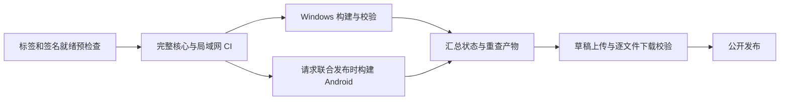

# 发布交付门禁

发布先完成预检查、完整核心/局域网 CI 和产物构建校验，再集中创建草稿、逐文件下载核对，最后公开。发布工作流与 PR 使用同一份 [CI](../.github/workflows/ci.yml)，调用同一提交的可复用工作流；GitHub 的依赖与复用语义见[工作流语法](https://docs.github.com/en/actions/reference/workflows-and-actions/workflow-syntax)及[复用文档](https://docs.github.com/en/actions/how-tos/reuse-automations/reuse-workflows)。



## 模式与当前状态

| 入口 | 模式 | Android 要求 |
| --- | --- | --- |
| 推送稳定版本标签 `vX.Y.Z` | 桌面独立发布 | 原生 APK job 跳过；完整 CI 仍验证手机/协议兼容 |
| 从对应标签手动运行，保持 APK 选项关闭 | 桌面独立发布 | 同上 |
| 从对应标签手动运行并启用 APK | 桌面与 Android 联合发布 | Android 构建、签名及实际 APK 校验均成功后才允许公开 |

标签须严格等于桌面 `package.json` 的版本；分支、不同版本和预发布标签会被拒绝。工作流只由最终 `publish` job 获得 `contents: write`，构建阶段禁止自动发布；同一 ref 的运行串行完成。

当前 Android 联合发布被明确阻断：[签名策略](../scripts/release-policy.json)为 `migration-required`。保留的历史 APK 是 `com.wallpaperplayer.mobile` / 0.1.4 / versionCode5，实际证书为 Android Debug；当前源码的 versionCode 也为5。迁移方案须覆盖既有安装的证书兼容、应用标识及数据/绑定保留，并递增版本码。两天有效的本地 QA 密钥测试只验证签名工具和门禁；正式升级验收尚未完成。Android 的签名和更新要求见[官方说明](https://developer.android.com/studio/publish/app-signing)。

Windows 策略目前记录签名状态，`desktopSigning.required` 为 false，沿用现有未签名产物策略；无效签名会被拒绝。生产代码签名仍待确认。要求签名时，策略需要明确证书 SHA256，产物必须为 `Valid` 且与该身份一致。

## 签名配置

签名材料通过 GitHub repository secrets 提供，仅在预检查或对应签名步骤注入，不转交完整验证工作流。策略文件只保留公开证书摘要和版本基线。

| Secret | 用途 |
| --- | --- |
| `WINDOWS_CSC_LINK` | 映射到 electron-builder 的 `CSC_LINK` |
| `WINDOWS_CSC_KEY_PASSWORD` | 映射到 `CSC_KEY_PASSWORD` |
| `ANDROID_RELEASE_KEYSTORE_BASE64` | 完整 JKS/PKCS12 文件的标准 Base64 |
| `ANDROID_RELEASE_STORE_PASSWORD` | keystore 密码 |
| `ANDROID_RELEASE_KEY_ALIAS` | 签名 alias |
| `ANDROID_RELEASE_KEY_PASSWORD` | key 密码 |

Android 使用 JDK21、API37 构建工具和 arm64-v8a，生成共享契约后再 prebuild。签名脚本将密钥解码到专属 Runner 临时目录，通过环境变量名向 apksigner 提供密码，并在成功或失败时删除该临时密钥文件。签名后的实际 APK 重新核对应用标识、版本、版本码、ABI、SDK 和证书。

## 产物清单

Windows 必须齐备安装包、便携版、blockmap、latest.yml 和三个官方插件。校验包含实际 PE/版本资源、Authenticode 状态，安装包与更新 YAML 的 SHA512/字节数，以及插件 ZIP 与打包时完整性清单的 SHA256。构建显式传入 `--x64`；NSIS/便携启动器本身可能为 ia32，清单分别记录启动器和目标架构。

联合发布另需一个已验证签名的 arm64 APK。构建 job 上传窄目录中的公共产物及 `part.json`；发布 job 下载后重新核对来源提交、必需角色、版本、ABI、签名声明、SHA256、SHA512 和字节数。重复名称、链接路径、传输篡改及不完整清单会被拒绝。

公开的 `release-manifest.json` 使用 schemaVersion1，记录标签、提交、平台、各端版本、APK应用/版本码/SDK、声明的最低服务协议、手机客户端协议、架构、签名状态、文件摘要和标签专属下载 URL。`clientProtocol` 由同次共享构建契约的 `PROTOCOL_VERSION` 生成，构建计划、Android分片与汇总不一致会拒绝；此字段是受控构建声明，手机没有重新解包候选APK读取协议。手机检查消费 Android 记录，并将文件名、版本/ABI、大小、SHA256与 GitHub 资产及固定仓库下载地址关联；桌面标签不参与手机版本比较。

## 手机更新发现

更新服务读取正式发布列表，跳过草稿、预发布及只有桌面或 IPA 的条目，并从较早发布寻找最新兼容 APK。每页20条，最多5页和20份手机清单，整个安装环境读取、请求与响应体共用15秒时限；调用方可传入 AbortSignal。列表响应上限1MiB、手机清单上限64KiB，使用 Expo 的流式 fetch 计数并在取消、超时或超限时关闭读取。达到扫描上限、相关清单损坏或传输失败会返回错误，不能将不完整扫描当作“已是最新”。GitHub 发布列表语义见[官方接口](https://docs.github.com/en/rest/releases/releases)。

Android 本地 Expo 模块通过 PackageManager/Build 读取实际安装的应用标识、版本名、版本码、当前签名证书、设备支持 ABI 与 SDK。它不以 JS package 版本、模拟器类型或默认 arm64 推断安装身份；模块缺失或多签名身份不明确时拒绝自动推荐，旧原生包和 Expo Go 需重新构建安装。当前仅接受相同应用标识、相同当前签名、支持的 ABI、满足 SDK/协议要求且版本码递增的更新；签名轮换/应用身份迁移不由选择器自动放行。签名字段的系统语义见[Android SigningInfo](https://developer.android.com/reference/android/content/pm/SigningInfo)。

更新检查自动关联当前导航顶层的电脑。导航订阅只发布设备/绑定ID，既不保留屏幕、Store或凭据，也不把背景设备列表探测当作当前电脑。检查从库页开始时同步固定所属电脑，读取该绑定的凭据，再重新核对公开身份与授权；普通连接仍拒绝不兼容客户端，更新专用路径可读取更高客户端要求以寻找升级方案。现代电脑使用info/auth请求；旧电脑保留已有64KiB鉴权探测，更新确认不跑线路测速或保存新地址、协议和最近连接时间。

兼容性同时检查两个方向：

| 字段 | 含义 | 检查 |
| --- | --- | --- |
| 电脑 `protocolVersion`、APK `minServerProtocol` | 电脑提供的协议与APK要求的最低电脑协议 | APK要求不高于电脑提供值 |
| APK `clientProtocol`、电脑 `minClientProtocol` | 手机提供的协议与电脑要求的最低手机协议 | APK提供值不低于电脑要求 |

旧清单缺少 `clientProtocol` 时仅按1处理，不能用它满足要求更高手机协议的电脑。全局/设备列表没有单一目标电脑，继续使用固定协议1基线，不扫描所有绑定或借用上次电脑结果；这不保证所有已绑定电脑都兼容，需在目标电脑页面重新检查。调用方可在全局入口显式提供已核实的 `serverProtocol`/`serverMinClientProtocol`；存在当前电脑时，显式值与新确认值不一致会被拒绝。

切换电脑、离开该电脑、重新绑定、移除绑定、导航卸载或多个活跃导航造成歧义时，旧检查失效。返回原电脑也不能复活旧结果；同电脑内部搜索/播放和媒体更新不改变身份范围。结果返回前再核对当前绑定，包含通知丢失的情况。原生环境、当前电脑确认和发布扫描共用原15秒截止时间；取消一个共享探测消费者不影响其他消费者。确认失败不会回退到猜测的协议1。

历史发布没有此清单。只为已逐项核验的 v1.4.0 / 手机0.1.4保留固定迁移索引，包含实际 arm64 APK 的应用标识、versionCode5、SDK24/36、调试证书和SHA256/大小；仍须与 GitHub 返回的资产摘要一致。其余旧 APK 不凭文件名自动信任，较新但缺少清单的 APK 会给出核对提示。线上 v1.5.1/v1.5.0 没有 APK 时仍能发现 v1.4.0；固定旧调试证书不代表正式签名迁移完成。

检查仅返回经元数据约束的官方 GitHub 地址，由现有界面交给系统打开。没有自动下载、安装 APK 或对下载文件重新计算摘要；清单中的签名状态是发布器声明，实际覆盖安装仍由 Android 校验证书与版本。iOS 当前没有已验收的发布通道，检查不会推荐 APK 或任意 IPA。

## 草稿、失败与重试

候选文件全部通过本地校验后，发布器创建带清单摘要标记的草稿。每个资产上传后都下载到独立校验目录，核对摘要和大小；汇总完整后才执行公开操作。上传、下载或清单错误会保留未公开草稿。

相同清单的自有草稿可复用已有资产；相同清单已经公开时只读核对并返回已发布状态。人工草稿、其他公开版本或不匹配的资产不能被覆盖。鉴权/网络错误不会被当作“版本不存在”，标签须预先存在。

GitHub 的创建、上传与编辑是多个请求，不能据此宣称整个远程过程为单个原子事务。最后公开请求的结果若因网络中断无法确认，使用相同候选再次读取和校验状态。对应 CLI 行为见[官方文档](https://cli.github.com/manual/gh_release_create)。

## 本地打包输出与失败恢复

`dist:win` 和 `pack:win` 分别生成完整发行包和目录包。源码按允许清单复制到项目树之外、每次新建的 ASCII 暂存子目录；Windows 目录复制使用 `robocopy /E /XJ /R:1 /W:1`，预先排除工作区自引用、插件大资源及核心不携带的模型目录。选定输入存在意外链接、目标非空、复制失败或复制后文件/目录清单与大小不符时停止。没有执行镜像清空或移动源目录；参数与退出码定义见[Microsoft 文档](https://learn.microsoft.com/en-us/windows-server/administration/windows-commands/robocopy)。

完整结果校验后保留为 `release/windows-<版本>-<UUID>/`，独立插件结果为 `release/plugins-<桌面版本>-<UUID>/`。每份结果携带所有权标记与 `official-package-integrity.json`；Windows 的 ASAR 内必须嵌入同一份插件摘要，并与随包 ZIP 匹配。源码的官方摘要不因打包而更新，新插件需配套相应桌面构建。

`.release/packaging/windows.json` 与 `plugins.json` 各自只保存一份最新成功结果，最后以单文件原子替换更新。结果完整写入但索引更新前中断，会留下未被选中的完整目录；并发构建互不清空，最后完成索引写入的成功者被选中。该保证不覆盖多文件远程事务或任意源码并发修改的一致快照。

发布校验读取 Windows 索引，要求 `distribution` 模式、当前版本和当前提交，并重新读取 ASAR、ZIP、PE 与更新摘要。目录包、未知所有者、索引/标记不一致、链接或不匹配提交会被拒绝；不会从历史平铺目录或另一份旧发行包补齐资产。可用以下命令查看本地选中的路径：

```powershell
$build = Get-Content -LiteralPath .release/packaging/windows.json -Raw -Encoding UTF8 | ConvertFrom-Json
Join-Path (Get-Location) $build.output
```

旧 `release/` 平铺文件、旧 `win-unpacked/` 和便携版 `Data` 不被删除或搬动。失败的暂存目录、失败候选和未选中结果留作诊断；仅成功且所有权、物理位置、后代无链接、无已知便携 Data 的当次暂存子目录自动清理。旧 QA 目录和故意含 junction 的夹具不递归清理。归档旧结果前须自行确认其中未放入运行中的便携用户数据。

压缩和运行时插件解压均使用固定 PowerShell 命令，通过环境变量传递实际路径，支持中文、空格、单引号、`&` 和 `$`；不把路径拼入命令文本。插件安装验证默认从最新 Windows 构建的 ASAR 读取官方摘要；手动指定 ZIP 时须同时指定配套的 `WALLPAPER_PLUGIN_TEST_APP_ROOT`。

## 本机证据与待完成项

`npm run verify:release-gate` 经数据保护入口运行。它覆盖512种预检查/CI/构建状态组合、清单与传输篡改、签名策略、草稿失败/重试，以及已公开候选的无修改复查；GitHub传输使用注入适配器，未调用真实发布接口。

[本批证据](evidence/r8-release-gate.json)另含 actionlint1.7.12 校验、107段 PowerShell 静态解析、历史1.4.0 EXE/更新元数据只读检查、实际 QA APK 重签与篡改拒绝。既有 Windows 包显示 `NotSigned`；系统已签名文件的证书读取只验证工具路径。没有构建新的生产 Windows/当前源码 APK、触发云 CI、创建真实草稿或发布。

[中文路径打包证据](evidence/r8-packaging.json)覆盖15组行为检查、真实 Electron44 x64 目录包与实际插件安装/启用/卸载/篡改拒绝，原有42个数据文件和历史发行物保持摘要。该目录包使用隔离 QA 入口和有界供应商资源夹具，不含当前前端，不证明 NSIS 安装/便携自解压、真实 AI 推理或全部运行时媒体路径；没有生成新生产安装包。

[手机更新发现证据](evidence/r8-mobile-updates.json)记录22组生产服务行为检查、实际发布器清单到手机消费者的往返、只读线上回退和独立 Android release QA包。优化后的 Hermes 原生包完成真实安装环境读取、Expo流式网络分页、签名/ABI拒绝、超限/超时/取消；服务端在结果回报前已观察到相应连接关闭。该包为测试签名、独立包名与最小入口，使用合成更新清单，没有下载或安装候选更新，不证明生产覆盖安装、实体arm64或iOS。

[当前电脑协议证据](evidence/r8-update-context.json)记录18组实际服务/导航/绑定与本地HTTP竞争检查，以及9项优化Android测试包检查。实际SecureStore重绑、导航变化、授权撤销和上下文截止均经过原生网络；自有服务在释放挂起响应前观察到4次关闭，卸载后上下文所有者/监听数归零。协议3电脑与候选声明为合成数据，当前共享实现仍为协议2，没有构建、下载或安装协议3更新。

用户确认DeepSeek前端完成后，[库页](../mobile/src/screens/LibraryScreen.tsx)首次连接失败分支已接入更新卡片，并保持成功后的设置入口。页面离开、后台、电脑切换和重绑会取消检查并清除结果；重试/失败不保留旧下载动作，打开前重新核对绑定。按钮补充明确的无障碍名称，失败页支持小屏滚动。

[前端整合证据](evidence/r8-frontend-integration.json)记录8组组件行为、当前桌面24种实际布局及完整Android界面的6项流程和补充滚动检查。独立R8/Hermes测试包加载当前完整生产UI，用合成绑定和自有目录传输验证可见更新路径；360×640dp、160%字号下检查/下载目标可完整滚入安全区域。协议3候选仅为元数据夹具，没有传输、安装候选APK或公开发布；iOS只有Hermes导出结果。

后续[Windows交付证据](evidence/r8-windows-delivery.json)已使用该阶段完整桌面源码及真实vendor/插件构建两个独立QA版本。本机Windows11的12项基础检查覆盖真实静默安装、覆盖升级、单实例、卸载重装、便携替换/移动、实际ACL拒绝写入与恢复、回退数据独立保留；8次合成绑定鉴权和原数据摘要检查通过。两个QA版本使用同一实现，不代表旧生产版本数据迁移或正式签名升级。静默安装的绝对路径/D参数使用末尾不加引号的形式，见[NSIS官方说明](https://nsis.sourceforge.io/Docs/Chapter3.html#installerusage)。

完整界面验收仍未关闭。开屏时钟混用后续已修复，11组回归、3项当前编译界面的实际Electron计时及24种布局检查通过，见[开屏修复证据](evidence/r7-splash-clock.json)；该阶段未重打分发包，旧Windows QA快照保持摘要，后续本机分发验收见下文。一次主题漂移尚未确定来源，两个版本的后续冷启动和字段级追踪未复现，原记录保留。原生回退通知仅验证生产请求参数，测试入口自动确认弹窗。正式Android身份与升级迁移、Windows签名策略、交互式安装/快捷方式、Windows10/其他11、多显示器、历史生产升级及云端完整构建/发布、实体设备/长时预算和原生iOS继续处理。

后续[主题追踪证据](evidence/r7-theme-trace.json)在冻结QA包执行生产入口前安装观察器，三种启动/收藏顺序从首次磁盘读取到提交落盘均保持深色，唯一提交字段为favorites，没有提前保存主题。原始失败同时还包含未归因的播放进度变更，不能因三项短场景通过而关闭异常；最终分发及长时界面验收继续保留设置/播放调用来源。观察器和调试参数隔离仅在QA内存中生效，包文件未改，测试后恢复合成设置、备份及9.9.1便携文件，QA进程归零。

[当前完整前端分发证据](evidence/r8-windows-frontend.json)新增包含开屏修复的真实9.9.2 QA安装包/便携包，七项安装版、重启、便携移动后的完整UI流程通过，均使用真实打包mpv；三项强化检查将原生截图与源视频目标帧比对。计划内主题切换均有对应设置提交，未出现未解释主题提交，原始孤立异常仍开放。该QA快照早于下述局部SVG圆角修改。

用户要求Astra审查后，桌面“视频理解”SVG仅补圆角端点/连接以显示两个小点，其余桌面与手机图标保留。已生成本地生产身份Windows1.5.1：[安装包](../release/windows-1.5.1-e1dfa8de-fc21-4143-bb95-02234b158364/Wallpaper-Player-Setup-1.5.1.exe)、[便携版](../release/windows-1.5.1-e1dfa8de-fc21-4143-bb95-02234b158364/Wallpaper-Player-1.5.1.exe)，配套插件在同目录plugins内。107项ASAR代码、24项vendor及七项发行资产验证通过，QA入口/观察器不存在。原始便携文件在独立Data中运行完整生产主进程/界面，实际mpv暂停、跳转后11秒帧比对及退出持久化通过。

该本地包保持生产版本1.5.1和既有依赖锁，使用固定本地Electron44.9.0；实测安装包、便携包和主程序均为NotSigned，未发布或覆盖现有生产安装。本批没有构建Android；正式签名/迁移及其他平台、环境和长时门槛仍沿用前述限制。[正式包证据](evidence/r8-svg-formal.json)保留Astra审查、SVG对照、产物摘要、运行与自有进程归零记录。

用户随后提供原生视频溢出截图。上一批包已用坐标断言复现顶栏被覆盖，现已修正原生视频的缩放换算、边界和播放器分区。当前本地替代产物为[修正版安装包](../release/windows-1.5.1-f5c8825c-0ff8-4eaa-8f3e-ce73b43dd88c/Wallpaper-Player-Setup-1.5.1.exe)与[修正版便携版](../release/windows-1.5.1-f5c8825c-0ff8-4eaa-8f3e-ce73b43dd88c/Wallpaper-Player-1.5.1.exe)，配套插件位于同目录plugins；`.release/packaging/windows.json`已指向该目录。旧目录作为历史验证快照保留。

修正版107项ASAR代码、24项vendor、七项资产通过核验，原始便携文件在独立Data中完成14项真实mpv边界检查，包括窄窗、100%至200%缩放、选项/列表、竖屏和实际全屏，六张原生截屏已检查。原始数据、历史公开产物及此前QA/正式包摘要保持，自有进程归零。版本仍为1.5.1，安装包/便携包/主程序仍为NotSigned，本地修订没有公开发布；手机、长时和历史主题异常未据此关闭。见[溢出修复证据](evidence/r7-native-player-overflow.json)。

## 应用图标修订包历史记录（2026-10-23）

用户选择的第 2 套渐变四宫格现已实际接入桌面标识、开屏、Windows 程序/安装包和手机图标配置。此前的 SVG 审查仅覆盖界面按钮，未接入 `build/icon-candidates` 的应用标识；旧包作为历史快照保留。

该批本地产物为[安装包](../release/windows-1.5.1-bd1dc541-a098-45a4-8bad-1c0571325fed/Wallpaper-Player-Setup-1.5.1.exe)和[便携版](../release/windows-1.5.1-bd1dc541-a098-45a4-8bad-1c0571325fed/Wallpaper-Player-1.5.1.exe)，插件位于同目录 `plugins`。构建完成时索引选择该目录，当前选择应读取 `.release/packaging/windows.json`。主程序、便携版和安装器均已核对实际嵌入的 9 个尺寸图标，完整生产界面的标识加载、播放器与布局检查通过；109 项 ASAR、24 项 vendor、七项资产及历史产物摘要通过核验。范围与预览见[应用图标证据](evidence/r8-app-icon.json)。

版本仍为 Windows 1.5.1，三项可执行文件实测 NotSigned，未公开发布或覆盖安装。Android 图标源码及独立测试包的验证不代表正式身份覆盖升级；正式签名/迁移、真机和 iOS 原生等限制继续保留。另见[播放器暂停修复](evidence/r6-player-visibility.json)：30 次实际生命周期和约 15 分钟可见性检查通过，但完整 20 分钟资源运行在空闲阶段被真实指针操作打断，未作为完整长时门槛通过。

## 当前本地启动改造集成包（2026-10-24）

最新本地产物为[安装包](../release/windows-1.5.1-58137ba9-9694-4cf2-bec4-221bffb20392/Wallpaper-Player-Setup-1.5.1.exe)和[便携版](../release/windows-1.5.1-58137ba9-9694-4cf2-bec4-221bffb20392/Wallpaper-Player-1.5.1.exe)，三个匹配插件位于同目录 `plugins`。索引已选择这一新目录，旧包保留。第 2 套 SVG、开屏及首次设置/声明式插件后台准备均已整合；115 项 ASAR、24 项 vendor 和 7 项资产匹配，实际 NSIS 提取的 ASAR 也与核验文件一致，没有执行安装器或覆盖生产安装。

原始便携文件在独立 Data 中完成旧 BOM 设置/1 万标签迁移、真实官方插件启动及公开设置脱敏。首轮 RGB 测试比较失败单独保留，颜色矩阵诊断后仅修正比较器，保持原阈值；同一数据的后续两次完整原生播放、跳转帧、窄窗/缩放边界、退出和重启保持通过，窗口未置顶，最后自有进程为零。安装器、便携版和主程序仍实测 NotSigned，没有公开发布。范围与全部摘要见[启动整包证据](evidence/r7-startup-distribution.json)。

本包使用本地固定 Electron44.9.0，默认冷下载、交互安装/升级、手机原生与正式签名迁移仍待验收。此前完成的 1207 秒 R6 长时结果见[旧冻结包的资源证据](evidence/r6-native-10k-resources.json)，该记录不改挂到本次新 ASAR；本批仅补齐启动改造的整包及短流程运行证据。

## 设置可读性与身份保护集成包（2026-10-24）

最新本地产物为[安装包](../release/windows-1.5.1-886566c7-b3f3-49f0-a779-cc9767b20f2e/Wallpaper-Player-Setup-1.5.1.exe)和[便携版](../release/windows-1.5.1-886566c7-b3f3-49f0-a779-cc9767b20f2e/Wallpaper-Player-1.5.1.exe)，匹配插件在同目录 plugins；当前索引选择此目录。深浅设置面板均为不透明底色并加强遮罩，设置期间隐藏重播按钮；身份读取失败保留原件、停止远程授权，支持修复后刷新。116 项 ASAR、24 项 vendor 与 7 项资产一致，实际便携程序四项深浅/窄窗检查和正常退出通过。历史包保留，仍未签名、未执行安装或公开发布；未对该 ASAR 新增长时/手机原生验收。原始记录、摘要和适用范围见[本轮证据](evidence/r8-identity-read-safety.json)。

## 当前远端正式版本：Windows 1.5.3（2026-10-24）

[公开发布页](https://github.com/zilu-fuck/wallpaper-player/releases/tag/v1.5.3) 已提供八项完整资产，源码标签 v1.5.3 固定在 8da66540f427b80030fcaab59d2ed552a8974d95。完整 CI 与发布流水线均成功，资产经过发布器上传后回下载核验；本机另验证实际公开安装器/便携版及关键 ASAR 代码，并使用独立便携 Data 完成深浅设置与访问记录隔离检查，未执行安装或覆盖生产配置。既有官方插件请安装本次发布附带的匹配 ZIP。

v1.5.2 候选未发布，失败标签原位保留；本地构建索引仍只表示本机成功构建，不改指向下载缓存。Windows 签名状态见公开清单；Android 签名迁移仍开放，手机源码推送不代表新 APK/iOS 发布。完整摘要、运行范围、原数据保留和剩余验收见[发布证据](evidence/r8-publication-1.5.3.json)。
